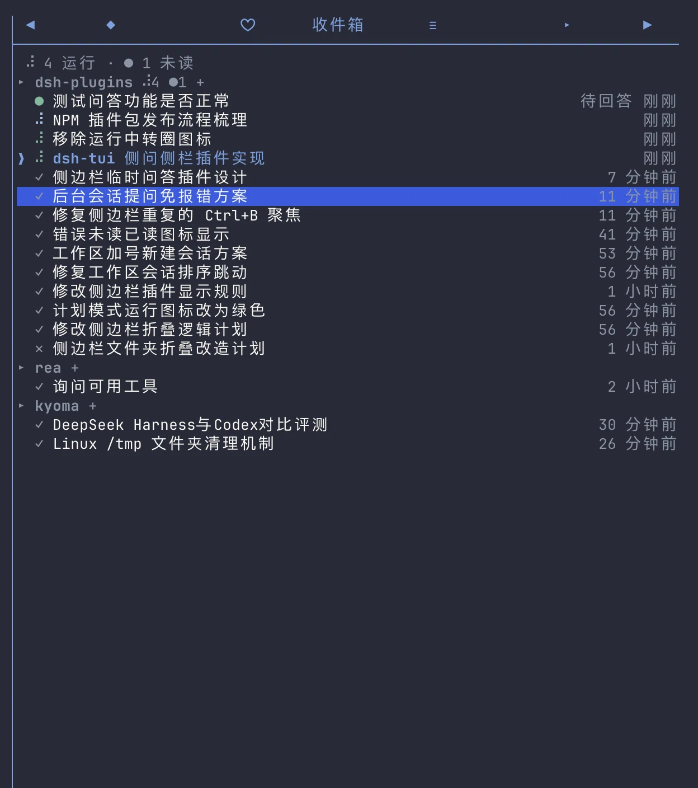

# dsh-tui-workspace-sidebar

[](https://github.com/Ding-Kyoma/dsh-tui-workspace-sidebar/actions/workflows/ci.yml)
[](https://www.npmjs.com/package/dsh-tui-workspace-sidebar)
[](LICENSE)

**English** | [简体中文](https://github.com/Ding-Kyoma/dsh-tui-workspace-sidebar/blob/main/README.zh-CN.md)

A light right-side panel for [dsh-TUI](https://github.com/ccch1mneyyy/dsh-TUI)
([dshtui.com](https://dshtui.com)) that answers one question at a glance:
**what is running, what finished while I was not looking, and where am I?**

This is a community plugin, not an official dsh-TUI component. It is built
against dsh-TUI 0.17.0 and uses only public host seams.

> **Status:** published as `dsh-tui-workspace-sidebar@0.1.3`. Install with
> `dsh plugin --profile dsh-tui add dsh-tui-workspace-sidebar`; the checkout
> install below remains available for development.

> **中文速览**：dsh-TUI 右侧收件箱侧边栏，按工作区列出正在运行、未读、待回答和
> 近期已读的会话。安装：
> `dsh plugin --profile dsh-tui add dsh-tui-workspace-sidebar`；界面语言跟随
> dsh-TUI 的 `/lang`，也可在插件配置里写 `lang: zh` 或 `lang: en`。完整中文说明见
> [README.zh-CN.md](https://github.com/Ding-Kyoma/dsh-tui-workspace-sidebar/blob/main/README.zh-CN.md)。

**Jump to:** [Install](#install) · [Config](#config) · [Languages](#languages) · [Privacy](#privacy-and-local-data) · [Development](#development) · [License](#license)

It uses a normal side-panel tab instead of a full-screen view: grouped by
project, one line per conversation, hover to highlight, click to jump. A `+`
after a project's status icons starts a fresh conversation in that workspace,
and a `⧉` on the header's right edge copies the workspace's absolute path to
the clipboard.

```
 2 运行 · ● 2 未读
▸ dsh-plugins ⠋ ● +              ⧉
  ● 后台计划                  待回答
  ● 重写 README               5 分钟前
  ⠋ 给补丁跑个验证            2 分钟前
❯ ✓ 修复登录页样式            刚刚
▸ other-project +                ⧉
  ✓ 更新部署脚本              3 小时前
↑↓ 选择 · Enter 跳转 · n 新建 · m 已读 · r 刷新
```



*The inbox in a dark dsh-TUI theme: running, waiting and read rows grouped by
workspace.*

## What it shows

Four kinds of conversations, across every workspace that is live in this TUI
process:

- **Running** — the session's agent is inside a turn. Row glyphs and each
  project's counter use the chat's own braille spinner, frame for frame (80
  ms): the counter borrows the row glyph's character, so the folder icon and
  the conversation icons turn together. The header keeps its muted chrome
  colour and is icon-only: `⠋` while anything there runs, `●` while something
  there is unread, with the numbers kept in the header total above. A row
  whose agent is in **plan mode** (the durable `plan/mode` selection written
  by `dsh-plan-mode`) spins in the theme's plan colour — sage green on the
  default dark palette, the same role the status line uses — while the
  project counter stays muted. Only a running row is coloured; a finished
  conversation never keeps it.
- **Finished but unread** — a turn ended while you were in another session. The
  row shows a solid dot `●` (`✕` when the turn failed) and is bold for the
  first few seconds.
- **Waiting for your answer** — a conversation called `ask_user_question` or
  `exit_plan_mode`. It uses the same green `●` as an unread finish, stays bold
  until the question settles, and carries a dim `待回答` (`needs you`) suffix so
  the two are distinguishable. This covers the conversation you are in as well
  as background ones: a foreground ask is claimed by dsh-tui itself (its
  questionnaire / plan-review panel is already on screen), and the sidebar still
  switches the row from the running spinner — plan colour included — to the
  green dot while that panel is open. The running counter includes a waiting
  row; the unread counter includes it only when it is not the attached
  conversation. Clicking a background row jumps to the session and the host's
  normal questionnaire / plan-review panel appears; only that explicit click
  releases the parked question — it never pops up while you are in another
  conversation. The original tool call is still waiting for that answer. See
  [Questions and plan reviews](#questions-and-plan-reviews).
- **Finished and already read** — jumping to a conversation (or pressing `m`)
  no longer removes it; the dot becomes a dim `✓` and the row stays for the
  rest of the retention window, so the place you just came from is still there.
  At most ten read rows are listed per project (see below).

A finished conversation — read or unread — is swept once it has been idle for
**7 days** (`retentionHours`, configurable). The attached conversation is
always listed and is the default selection: a `❯` cursor marks it while the
panel has focus, and a tinted title keeps it findable otherwise. Its row is
never filled; only the row under the mouse gets the highlight background. It is
pinned regardless of age while you are in it.

Inside a project, rows are grouped by what wants attention first: **finished but
unread** conversations and **parked questions** lead, then **running** ones, then
everything already dealt with (read finishes, which includes the attached
conversation once its turn is over). Within a class rows are ordered by when their
**current state began**, not by their latest event: a running row is anchored to
the start of its current turn, a finished row to the moment it finished, and a
waiting row to the moment the question was parked. Activity inside a turn —
tokens, tool calls, step markers, background job events — never reorders the
list, so two conversations running at the same time keep a fixed relative order
instead of trading places on every event. A new turn lifts its row once, and an
exact tie falls back to the session id. Projects follow the same class priority,
so the conversation that wants attention still leads the panel. Inside a class
the workspace whose newest state change is most recent rises to the top, so the
workspace you just started a turn in (or whose turn just finished) leads its
class instead of staying at the slot where it first appeared. The key is the
same anchor rows use — the current turn's start while running, the finish marker
once done, the parked moment while a question waits — so activity inside a turn
never reshuffles the projects, and a workspace moves once per state change. An
exact tie falls back to the slot where the project first appeared, then to its
path. The relative time on the right still reports the last activity (it is also
what the retention window uses).

Each project lists at most **10 already-read** conversations. Running, waiting
and unread rows are never capped, and the attached conversation always keeps a
slot: when it is an older read row it displaces the tenth, so the panel never
loses the row you are on. The cap is display-only — the state file still retains
everything the retention window allows, so the next-oldest conversation appears
when one of the kept rows expires.

The ten-row cap also adapts to the panel height. The panel body is a fixed
number of lines, and each project heading takes one of them; with many
workspaces, ten read rows each would overflow it. When that happens the cap is
lowered for every project together — 9, 8, … — and stops at the first value
whose grouped list fits, so the panel keeps as much history as the height
allows. It never goes below **3 read conversations per project**: at that floor
the list scrolls as before. Folding is display-only and temporary: running,
waiting, unread and attached rows are never folded, the state file still keeps
everything, and a taller panel (or a shrinking history) brings the folded rows
back. The header counts the conversations actually listed.

Everything else is hidden: idle sessions that never ran, subagents, and
projects with nothing to triage. The attached session is never counted as
unread (no badge for the conversation already on screen). A waiting row is also
never swept by the retention window — the question is still waiting for an
answer, so its green dot stays until the tool call settles.

When the list overflows, the wheel scrolls the window one conversation per
notch instead of moving the selection: a flick can take the attached row off
screen, and `↑`/`↓` brings the highlight back into view. The panel opens on the
attached conversation, so the first frame already shows where you are even when
that row sits deep in the list.

## Install

Requires Node.js `^22.19 || >=24` and dsh-TUI 0.17.0.

Install from npm:

```sh
dsh plugin --profile dsh-tui add dsh-tui-workspace-sidebar
```

For development from a checkout:

```sh
git clone https://github.com/Ding-Kyoma/dsh-tui-workspace-sidebar.git
cd dsh-tui-workspace-sidebar
npm ci
dsh plugin --profile dsh-tui add link:$PWD
```

Then restart the TUI (a newly added bundle is not picked up by a running
process). The tab appears as `▣ 收件箱` (or `▣ Inbox`); `Ctrl+B` opens the
sidebar, `[`/`]` cycle panels, and the panel is also listed by `/panel`.

If you previously linked an older `@local/dsh-tui-workspace-sidebar` checkout,
remove that row before adding this package: two activations cannot own the same
panel/scene ids.

The plugin also registers:

- `/ws` — open the sidebar panel. It is declared in `dsh-plugin.json`
  (`workspace-sidebar.ws`, contract `commands.dsh/v1alpha1#Command`, permission
  `commands.invoke`), so a host with a verified Component identity registers it
  through the mediated command surface; older hosts fall back to the public
  `commands` service.
- `alt+w` — same, configurable or disable with `shortcut: off`.

## Compatibility

- dsh-TUI 0.17.0: the panel, scene, command and question seams used here are the
  public 0.17.0 surfaces.
- Community manifest v0.15 (`dsh.community`), host facet `v1alpha1`, with the
  `commands.dsh/v1alpha1#Command` contract and the `/ws` permission closure.
- Node.js `^22.19 || >=24`.
- Developed and tested on macOS. The runtime uses only Node built-ins and the
  host-provided React/UI kit; Linux should work, Windows is untested.

## Project layout

| File | Role |
| --- | --- |
| `index.js` | Cordis entry: `name` / `Config` / `apply`, panel + scene + command + shortcut wiring |
| `model.js` | Pure row/group/order/glyph rules, no I/O |
| `tracker.js` | Folds the live agent registry and session events into rows |
| `store.js` | Debounced, atomic, quarantining JSON state |
| `panel.js` | The sidebar component |
| `jump.js` | One-shot queue and transition scene |
| `questions.js` | Waiting-dot observation and background-question relay |
| `current.js` | Attached-session probe |
| `strings.js` | English/Chinese copy and language resolution |

## Config

Patch the row by id in the profile's own `cordis.patch.yml` (a row patch
replaces the whole `config`, so restate every key you need):

```yaml
- id: workspace-sidebar
  config:
    lang: auto                                  # auto | zh | en
    stateFile: ~/.dsh-tui/workspace-sidebar.json
    shortcut: alt+w                             # off disables it
    retentionHours: 168                         # 7 days; 0 = drop a row as soon as it is read
    relayQuestions: true                        # false disables parking background questions
```

`retentionHours` accepts fractions (useful to watch the sweep happen) and is
capped at 720 (30 days). The default is 168 (7 days). The row cap of 300 stays
as a hard bound.

`relayQuestions` is on by default. It is the parking fallback for background
`ask_user_question` / `exit_plan_mode` (see below); set it to `false` if the
host already handles those questions itself, or if you want the old immediate
`NO_PROVIDER` behavior back. It does **not** disable the waiting dot: the dot
of a question the host is already showing (including the attached session's
own questionnaire / plan review) is pure observation and stays on either way.

## Languages

The panel is bilingual: every label it draws — the tab title, header, empty
state, row suffixes, footer hints, toasts and the transition card — comes from
`strings.js` in English and Simplified Chinese. Relative times (`5m ago` /
`5 分钟前`) follow the same language.

The language is resolved in this order:

1. the plugin's `lang` config (`zh` / `en`; `auto` by default),
2. the host's live UI language (what `/lang` and `dsh-tui.lang` set),
3. `DSH_TUI_LANG`,
4. `~/.dsh-tui/lang.json`,
5. the OS locale (Chinese locales → `zh`, everything else → `en`).

With `lang: auto` (the default), `/lang` switches the panel content on the next
repaint. A pinned `lang: zh` or `lang: en` always wins. The panel tab title and
the `/ws` command description are registered when the plugin activates, so they
keep the old language until dsh-TUI restarts. The `dsh-plugin.json` manifest
metadata is English-only host metadata.

## Interaction

| Input | Action |
| --- | --- |
| hover a row | fill it (transient; selecting a row does not fill it) |
| click a row | jump to that workspace + session |
| click a project's `+` | start a fresh conversation in that workspace (see below) |
| click a project's `⧉` | copy that workspace's absolute path, confirmed for three seconds (see below) |
| `↑` / `↓` | move the selection (while the panel is focused) |
| `Enter` | jump to the selected conversation |
| `n` | start a fresh conversation in the selected row's workspace |
| `m` | mark the selected finished row as read (the row stays, dimmed) |
| `r` | refresh the agent roster and workspace titles |
| wheel | scroll the list one conversation per notch (the selection stays put; `↑`/`↓` brings it back) |

## How a switch works

A plugin panel gets no `channel`, so it cannot call `channel.resumeTo` or
`channel.switchWorkspace` itself. The only public seam that hands a plugin a
live channel is a registered scene. The panel therefore leaves a one-shot
target in a queue and opens a small transition scene; that scene performs the
action and closes. A row click queues a resume; a project's `+` (or `n`) queues
a new-session request.

The panel and the scene are registered from **one** injected context on
purpose. dsh-tui attributes resource ownership to the calling activation
context, and `host.openScene()` checks the scene's owner against the panel's
owner. Registering them from two sibling `ctx.inject` callbacks gives them two
different fibers, so the host refuses to open the scene ("belongs to another
activation") even though `sceneReady()` is true. One injection for both
(`['tuiPanels', 'tuiScenes']`) keeps the owners identical.

Expect a brief full-screen card (`▣ project / title / 正在打开会话…`) for the
duration of a jump. It is a trampoline, not a second inbox; there is no
workspace list there.

Failure reasons are mapped to toasts and the row stays unread: `occupied`
(another TUI terminal holds the session, with its pid), `working`,
`cancelled`, `failed`, `unavailable` (the adapter already toasts this one).
A successful jump marks the row read but keeps it in the list, so the
conversation you came from is still one click away until its window closes.

### New session from a workspace header

`+` sits after the running/unread status icons on every project header, just
left of the right-edge copy icon. Its cell is padded on both sides, so the click
target is a little wider than the glyph; `n` does the same for the workspace of
the selected row. The `+` is omitted for the "unknown project" bucket, which
has no cwd to start a session in. Clicking it behaves like `/new` inside that
workspace.

| attached session | clicked workspace | what happens |
| --- | --- | --- |
| idle | the attached one | `/new` (`channel.newSession()`) |
| idle | another one | workspace handoff (`channel.switchWorkspace()`) |
| running a turn | the attached one | `/bg` first (`channel.backgroundCurrent()`); the fresh session it creates is already in that cwd |
| running a turn | another one | `/bg`, then the workspace handoff on the now-idle fresh session |

A running turn is never killed: it keeps going as a background session and
stays listed with its spinner. An idle session is replaced `/new`-style, and
its row stays in the list as a read finish. The fresh conversation itself joins
the list once it has a prompt (never-prompted idle sessions stay hidden, as
before). When the host refuses (a turn started in between, the directory
disappeared, the handoff failed) the channel's own notice explains why and the
card closes. A kernel that exposes neither `newSession` nor `switchWorkspace`
gets "当前内核不支持新建会话".

### Copy a workspace path

The right edge of every project header carries a `⧉`: clicking it puts that
workspace's **absolute path** on the system clipboard and shows "Path copied"
for three seconds on the host's notice surface. `+` keeps its place after the
status icons; the flexible gap between the two is what pins `⧉` to the panel's
right edge, so every project's copy target lines up in one column and repeated
clicks do not need to be re-aimed. Its cell is padded on both sides too, so the
click target is wider than the glyph.

- **What is copied** — the normalised path the groups are keyed by: trailing
  `/` removed, `\` folded to `/`. It is the same path `/new` and the workspace
  handoff use.
- **No icon for the unknown bucket** — a header whose rows have no cwd renders
  neither `+` nor `⧉`, and reserves no gap for them.
- **How the write happens** — the plugin reuses dsh-tui's own clipboard
  implementation (`setClipboard` in `lib/types/ink/termio/osc.js`): native tools
  first (macOS `pbcopy`, Windows `clip`, Linux `wl-copy`/`xclip`/`xsel`), then
  the tmux paste buffer, then the OSC 52 sequence written to stdout — the same
  path a mouse selection copy takes. That module is not in the host's public
  export map, so it is located through the running process's
  `DSH_PROFILE_DIR`; if a future release moves the file, the plugin falls back to
  its own "native tool + OSC 52" writer. Over SSH the native clipboard is never
  touched (it would be the remote machine's).
- **Toast length** — the public `tuiToast.show(text, { timeoutMs: 3000 })`
  service is used so the confirmation really lasts three seconds; when it is
  unavailable the panel falls back to `host.toast` (fixed at four seconds by the
  host).
- **No keyboard shortcut** — `⧉` is pointer-only; keyboard navigation
  (`↑`/`↓`/`Enter`/`n`/`m`/`r`) is unchanged.

## Questions and plan reviews

Every ask — the attached session's own `ask_user_question` / `exit_plan_mode`
included — is dispatched on the Cordis `user-questions/request` waterfall. The
plugin listens at the **front** of that chain (`prepend`), because dsh-tui's
answerer claims the attached session's request and never calls `next()`: a
listener registered after it would never see the question that is on screen
right now. The listener still calls `next()` first and only observes the
returned promise, so the answer value, the rejection identity and the host's
panel are exactly what they were. While that promise is unsettled the row is
marked waiting (green `●` + `待回答`); answering, cancelling, a timeout or an
aborted turn clears it. That is why the conversation you are in shows the green
dot, rather than its plan-colour spinner, while its questionnaire or plan review
is open.

dsh-tui 0.17.0's answerer is bound to the session attached to the channel: it
claims `user-questions/request` only when `request.agent.id` is the current
channel agent, and calls `next()` for every other agent. A **background** session
that calls `ask_user_question` / `exit_plan_mode` therefore ends the ask at
`NO_PROVIDER` ("no user-questions answerer accepted the request"), which used to
surface as a failed tool call and a stalled-looking background turn.

For those the plugin registers a fallback answerer on the same waterfall:

1. it calls `next()` first, so the host (or any other answerer) always gets the
   first chance;
2. it only takes over when the chain rejects with `NO_PROVIDER` **and** the
   asking agent is not the attached session — a foreground failure is never
   masked;
3. it parks the request, marks the row waiting (green `●` + `待回答`), and keeps
   the original tool call pending instead of failing it;
4. the question is re-dispatched **only when the row is clicked in the inbox**:
   the jump scene adopts the session and then calls the relay's explicit
   `deliver()`. The host's answerer now claims it, the normal questionnaire /
   plan-review panel appears, and the answer resolves the parked tool call. A
   cancellation (`ASK_CANCELLED`) propagates normally, so cancelling a plan
   review keeps you in plan mode instead of producing a `NO_PROVIDER` error.

This is intentionally not automatic. The TUI's question store is shared across
conversations, and its answerer is bound to whichever session the channel is
attached to; a relay that watched attachment on its own would re-dispatch a
background question as soon as that session became current anywhere in the
process, and the panel could then surface in the conversation you are using.
The relay therefore never reads the attached session to decide delivery (it
only uses it to distinguish a foreground `NO_PROVIDER` from a background one).
The inbox click is the explicit "handle this now" consent; the green dot is the
only advance notice.

The relay is deliberately a fallback, not a second question provider:

- it yields to every other answerer on every request, so once dsh-tui handles
  background questions itself it simply never parks anything;
- the `FORWARD` marker is a private Symbol, so the plugin's own listener cannot
  park its re-dispatch a second time;
- a `NO_PROVIDER` from the re-dispatch (the jump has not landed yet) keeps the
  question parked; the next inbox click tries again. Other unexpected errors
  stay parked and log once; a cancelled/aborted turn settles the parked ask;
- `relayQuestions: false` disables the parking half only. The waiting dot of a
  question the host is already showing is observation, not relay, and stays on.

The turn stays blocked while the question is parked, exactly like a foreground
question waiting for an answer. Open the row from the inbox to release and
answer it, or cancel the turn — opening the session by another route (`/resume`,
the session screen) leaves the question parked, because only the inbox click
releases it. A timed `ask_user_question` still times out to `{ pending: true }`;
the row's green dot then clears without an answer. The question is in-memory
only: if the process exits while it is parked, the question is gone with the
tool call.

## Persistence

State lives in `~/.dsh-tui/workspace-sidebar.json` (mode `0600`, atomic
rename, debounced writes):

```json
{
  "version": 1,
  "sessions": {
    "<session id>": {
      "cwd": "/Users/you/project",
      "title": "Fix the login page",
      "status": "finished",
      "failed": false,
      "updatedAt": 1761000000000,
      "finishedAt": 1761000000000,
      "seenAt": 0
    }
  }
}
```

A row persisted as `running` is dropped on the next start: the previous
process died mid-turn, so there is nothing this process can report about it.
Finished rows survive restarts with their titles and read state — read ones
included, until their retention window closes. Rows past `retentionHours` (or
beyond the 300-row cap) are pruned, and a hidden panel still sweeps them on
time through one unref'd timer, so the tab badge shrinks without being opened.
The `waiting` / `waitingAt` flags are in-memory only: the store's field
whitelist drops them, so a restart never shows a green dot for a question whose
tool call is gone. A corrupt file is preserved as
`workspace-sidebar.json.corrupt-<epoch>` before an empty state is used.

Raising `retentionHours` is forward-looking: a row that was already pruned is
not rebuilt from the session logs. Resuming that conversation makes it a live
row again.

## Privacy and local data

The plugin is local-only: it makes no network requests, sends no telemetry and
runs no shell commands. It reads:

- `~/.dsh-tui/inject/servers.json` — the documented cross-process signal that
  names the session this TUI process currently serves;
- `~/.dsh-tui/lang.json` — the saved UI language;
- live agent/session events in memory, for the running, unread and waiting
  states.

It writes one file, `~/.dsh-tui/workspace-sidebar.json` (mode `0600` on POSIX,
atomic rename, debounced writes). That file contains session ids, titles, cwd,
timestamps and read state. Treat it as sensitive: titles and cwd can reveal
project names and paths. It does not read session logs from disk, does not store
message contents, and drops the in-memory `waiting` flags on save.

Like every dsh-TUI plugin, this code runs trusted-in-process with the same
permissions as the TUI; there is no sandbox. See [SECURITY.md](SECURITY.md) for
the reporting path and the full data-handling note.

## Limitations

- **Same process only.** The plugin folds the core agent registry
  (`ctx.agents`) and the live session event logs of this TUI process. dsh-tui
  0.17.0 exposes no cross-process roster, so conversations that only exist on
  disk are invisible until resumed.
- **Parked questions wait for a jump.** A background question keeps its turn
  blocked until you jump to the row and answer it (or cancel the turn). The
  green dot is the prompt; the question is not persisted, so a process exit
  discards it. The relay only sees this process's agents.
- **Waterfall dependency.** The relay uses dsh-tui 0.17.0's
  `user-questions/request` waterfall and yields to the host first. It registers
  with `prepend` so it stays outermost: the host's answerer claims the attached
  session's ask without delegating, and only an outer listener can observe that
  question. A future host that prepends its own claiming answerer could hide a
  foreground ask from the dot; a host that stops dispatching the event leaves
  the parking fallback inert (the original `NO_PROVIDER` returns). It never
  patches dsh-tui.
- **Panel id and the settings picker.** The package ships a `dsh-plugin.json`
  (`id: workspace-sidebar`), so the host admits the activation and the panel
  keeps the durable id `workspace-sidebar:inbox` across runs. Without that
  manifest the id would be the anonymous `session:actN:inbox`, and the settings
  picker would show "临时面板 #N · 仅本次运行，不保存" because it refuses to
  persist an address no later run can honour (issue #1695 upstream). The id is
  still re-resolved from `panels.list()` on every activation rather than
  assumed. The same manifest declares `/ws` with the `commands.dsh/v1alpha1`
  contract and the matching `commands.invoke` permission, so the mediated
  command surface accepts it; older hosts fall back to the global `commands`
  service. If your `sidePanel.panels` is an explicit list written before the
  manifest existed, tick the inbox once in `/settings`; that choice now
  persists.
- **Transition card.** The full-screen flash is the only public-API path to a
  session switch in 0.17.0. If a direct `host.openSession`-style API appears,
  the panel will prefer it and keep the scene as a fallback.
- **New sessions need the scene too.** `+` and `n` use the same registered
  scene; without `tuiScenes` they toast "无法新建：场景服务不可用" and do
  nothing. Backgrounding a running turn creates its fresh session in the cwd
  being left, so a cross-workspace `+` hands off once more; the intermediate
  session is disposed immediately and (per the host's fresh-session policy) is
  not written to disk, though the host's workspace ledger may briefly record
  its id.
- **Non-DSH kernels.** A kernel that does not provide the `agents` service
  (for example the Claude/Codex adapters) gets recent rows from disk only; the
  panel says so instead of pretending to be live.
- **Pinned current row.** The attached conversation is never swept while it is
  attached, even after a long idle stretch. Switch away and it expires with the
  rest at the next sweep.
- **One lifecycle.** Do not install two copies under different names: the
  second activation cannot register the same panel/scene ids.
- **Copying rides on a host-internal file.** `⧉` prefers dsh-tui's
  `lib/types/ink/termio/osc.js`, which is not in the host's public export map, so
  it is located through `DSH_PROFILE_DIR` (or `DSH_HOME` + `DSH_PROFILE`) to hit
  the copy that is actually running. If a future dsh-tui moves it, the plugin
  falls back to its own "native tool + OSC 52" writer and the feature keeps
  working; if no clipboard is reachable at all it toasts a failure instead of
  pretending. Over plain SSH with a terminal that ignores OSC 52 (iTerm2's
  default, for example) the write can be silently lost — the same limit
  dsh-tui's own selection copy has.
- **No confirmation in a fullscreen panel.** The three-second toast renders on
  the chat column's notice surface; the copy itself still works when the sidebar
  is zoomed to fill the screen, but the confirmation is not visible.

## Development

```sh
npm ci
npm test
npm run check:manifest
npm pack --dry-run
```

There is no build step; the package ships the ESM sources directly. The test
suite uses `node --test` and temporary directories, so it never touches the real
`~/.dsh-tui` state. CI runs the same commands on Node 22.19 and 24.

Releases are tag-driven; see [CONTRIBUTING.md](CONTRIBUTING.md). 0.1.0 was
bootstrapped with a manual publish; later releases use npm trusted publishing
and include provenance.

## Tests

```sh
npm test        # node --test: config, model, tracker, store, current, jump, apply, strings, panel, copy, questions, manifest
```

The tests cover the transition table (`running → finished → seen`), the
retention window (visibility, pruning, next-expiry), the current-session rule
(listed, pinned, never unread), the triage classes (unread, running, read) and
the ordering anchor inside them (running rows anchored to their turn start,
finished rows to their finish marker, so concurrent running conversations never
swap as their logs advance, and the workspace whose state changed most recently
leads its class while in-turn activity leaves the group order alone), subagent
and no-prompt filtering, grouping, store
atomicity/corruption, the jump failure matrix, the new-session decision table
(`/new` vs workspace handoff vs `/bg`, refusals and thrown host calls), the
workspace `+`/`n` affordance (including the hidden unknown-project case and
the padded `+` after the status icons), the
animated row glyphs and icon-only project counters (the same character as the
row glyphs at every frame, still in the muted header colour; the header total
is static and holds the numbers), the plan-mode spinner colour (row-only), the
per-project cap on read rows (running and
unread exempt, attached row pinned), the height-adaptive folding of read rows
(cap lowered until the grouped list fits, a floor of three per project, and a
taller panel revealing the folded rows again), the right-pointing project glyph,
hover-only row fill, and the
panel/scene/command/shortcut registration (including feature-detected
degradation).

The copy tests cover the host-module lookup order (`DSH_PROFILE_DIR` →
`DSH_HOME`/`DSH_PROFILE` → package resolution), emitting the sequence
`setClipboard` returns, the fallback when that module is missing or throws, the
per-platform native command choice and order, never touching the native
clipboard over SSH, the UTF-8 base64 payload of the OSC 52 sequence, and the
failure paths for an empty path and a broken stdout. The panel side covers the
right-edge icon with `+` unmoved, copying the normalised path, the three-second
confirmation (`timeoutMs: 3000`), falling back to the panel toast when the toast
service refuses or throws, the failure toast, and a cwd-less group rendering
neither the icon nor the reserved gap.

The question tests cover the prepended registration, the waiting dot of an ask
the host claims (the attached session's own questionnaire / plan review), the
dot beating the plan spinner, concurrent asks keeping the row waiting until the
last settles, cancellation and error pass-through with the original identity,
the `next()`-first pass-through, parking on `NO_PROVIDER`, explicit delivery
after an inbox jump (and that changing the attached session alone never
forwards), retrying a forwarded `NO_PROVIDER` on a later click, `ASK_CANCELLED`
and aborted turns, disposal, unexpected errors, agentless requests, the private
forward marker, the foreground `NO_PROVIDER` guard, multiple parked asks per
agent, a double click while a forward is in flight, `relayQuestions: false`
disabling parking but not the dot, and the green-dot row / header counts /
non-persistence of the waiting flag. The manifest tests cover the v0.15 shape,
the `/ws` command/contract/permission closure and the publish metadata; the
config test covers the Cordis defaults and type rejection; the apply tests also
cover the mediated command surface and the global-service fallback.

`strings.test.mjs` also checks that both dictionaries carry the same keys,
types and `{{placeholder}}` sets, and that the language-resolution order
(config > live host language > `DSH_TUI_LANG` > `lang.json`) is stable.
`panel.test.mjs` renders the same rows in English as well as Chinese.

## Uninstall

```sh
dsh plugin --profile dsh-tui remove dsh-tui-workspace-sidebar
```

Use the package name you installed (an older `link:` checkout may be listed under
its old name). Removing the plugin takes the panel, scene, command and shortcut
out of the profile; it does **not** delete user data. To remove the sidebar
state, delete `~/.dsh-tui/workspace-sidebar.json` yourself. The only other file
it may write is the `workspace-sidebar.json.corrupt-<epoch>` quarantine of an
unparseable state file.

## License

MIT © 2026 [Ding-Kyoma](https://github.com/Ding-Kyoma). See [LICENSE](LICENSE).
