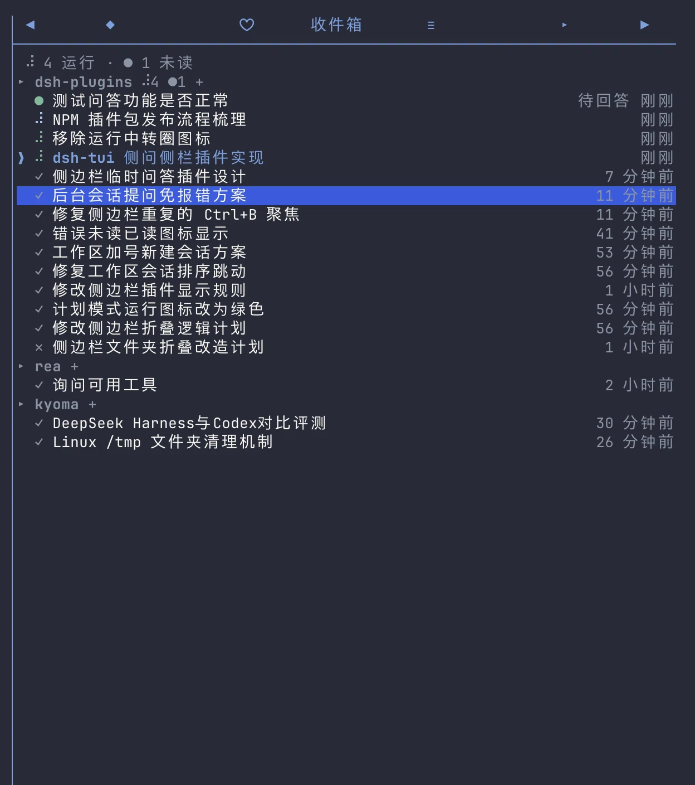

# dsh-tui-workspace-sidebar

[English](https://github.com/Ding-Kyoma/dsh-tui-workspace-sidebar/blob/main/README.md) | **简体中文**

[](https://github.com/Ding-Kyoma/dsh-tui-workspace-sidebar/actions/workflows/ci.yml)
[](https://www.npmjs.com/package/dsh-tui-workspace-sidebar)
[](LICENSE)

一个为 [dsh-TUI](https://github.com/ccch1mneyyy/dsh-TUI)（[dshtui.com](https://dshtui.com)）提供的轻量右侧面板，让你一眼看清一个问题：**什么正在运行、我没看的时候什么已经结束，以及我当前在哪里？**

这是一个社区插件，并非 dsh-TUI 官方组件。它基于 dsh-TUI 0.17.0 构建，只使用公开的宿主接缝（host seams）。

> **状态：** 已发布为 `dsh-tui-workspace-sidebar@0.1.2`。安装命令：
> `dsh plugin --profile dsh-tui add dsh-tui-workspace-sidebar`；下文从代码检出安装的方式仍可用于开发。

> **中文速览**：dsh-TUI 右侧收件箱侧边栏，按工作区列出正在运行、未读、待回答和
> 近期已读的会话。安装：
> `dsh plugin --profile dsh-tui add dsh-tui-workspace-sidebar`；界面语言跟随
> dsh-TUI 的 `/lang`，也可在插件配置里写 `lang: zh` 或 `lang: en`。完整英文说明见
> [README.md](https://github.com/Ding-Kyoma/dsh-tui-workspace-sidebar/blob/main/README.md)。

**快速跳转：** [安装](#安装) · [配置](#配置) · [语言](#语言) · [隐私与本地数据](#隐私与本地数据) · [开发](#开发) · [许可证](#许可证)

它使用普通的侧边面板标签页，而不是全屏视图：按项目分组，每个会话一行，悬停高亮，点击跳转。项目状态图标后的 `+` 可在该工作区启动一个新会话。

```
 2 运行 · ● 2 未读
▸ dsh-plugins ⠋ ● +
  ● 后台计划                  待回答
  ● 重写 README               5 分钟前
  ⠋ 给补丁跑个验证            2 分钟前
❯ ✓ 修复登录页样式            刚刚
▸ other-project +
  ✓ 更新部署脚本              3 小时前
↑↓ 选择 · Enter 跳转 · n 新建 · m 已读 · r 刷新
```



*深色 dsh-TUI 主题下的收件箱：运行中、待回答和已读的行按工作区分组。*

## 显示内容

四种会话，覆盖此 TUI 进程中所有活跃的工作区：

- **运行中** — 该会话的 agent 正处于一个回合中。行字形和每个项目的计数使用聊天自身的盲文 spinner，逐帧同步（80 毫秒）：计数借用行字形的字符，因此文件夹图标和会话图标一起转动。标题栏保持其柔和的界面颜色，并且只显示图标：有任务运行时显示 `⠋`，有未读内容时显示 `●`，具体数字保留在上方标题栏总计中。agent 处于**计划模式**（由 `dsh-plan-mode` 写入的持久化 `plan/mode` 选择）的行会以主题的计划颜色旋转——默认深色调色板下为鼠尾草绿，与状态行所用的颜色角色相同——而项目计数保持柔和色。只有运行中的行才着色；已结束的会话绝不会保留该颜色。
- **已结束但未读** — 当你在另一个会话中时，某个回合结束了。该行显示实心圆点 `●`（回合失败时显示 `✕`），并在最初几秒内加粗。
- **等待你的回答** — 调用了 `ask_user_question` 或 `exit_plan_mode` 的会话。它使用与未读结束相同的绿色 `●`，一直加粗直到问题解决，并带有暗色的 `待回答`（`needs you`）后缀，以便两者区分。这既包括你当前所在的会话，也包括后台会话：前台的提问由 dsh-tui 自身接管（它的问卷/计划审核面板已经在屏幕上），而当该面板打开时，侧边栏仍会将该行从运行中的 spinner——包括计划颜色——切换为绿色圆点。运行计数包含待回答的行；未读计数仅在它不是当前附着的会话时包含它。点击后台行会跳转到该会话，并出现宿主常规的问卷/计划审核面板；只有这一显式点击才会释放被搁置的问题——当你在另一个会话中时，它绝不会弹出。原始工具调用仍在等待该回答。参见[问题与计划审核](#问题与计划审核)。
- **已结束且已读** — 跳转到某个会话（或按 `m`）不再移除它；圆点变成暗色的 `✓`，该行会在保留期内一直存在，因此你刚离开的位置仍然找得到。每个项目最多列出十行已读记录（见下文）。

已结束的会话——无论已读还是未读——在空闲 **7 天**后会被清扫（`retentionHours`，可配置）。当前附着的会话始终列出，并且是默认选中项：面板获得焦点时用 `❯` 光标标记它，否则用带色调的标题让它保持可发现。它的行永远不会被填充；只有鼠标下的行会有高亮背景。只要你在其中，无论它空闲多久都会固定显示。

在一个项目内部，各行按需要关注的程度分组：**已结束但未读**的会话和**被搁置的问题**排在最前，然后是**运行中**的会话，最后是所有已经处理过的内容（已读的结束记录，其中包括当前附着的会话在其回合结束之后）。在同一类别内，各行按**当前状态开始**的时间排序，而不是按最近事件：运行中的行锚定到当前回合的开始，已结束的行锚定到结束的时刻，待回答的行锚定到问题被搁置的时刻。回合内的活动——token、工具调用、步骤标记、后台任务事件——绝不会重排列表，因此两个同时运行的会话保持固定的相对顺序，而不会在每次事件时互换位置。新回合只会让它的行上移一次，若完全并列则回退到按会话 id 排序。项目遵循相同的类别优先级，因此需要关注的会话仍然排在面板最前面。在同一类别内，内部最新一次状态变化的工作区升到最前面，所以刚开新回合（或某一回合刚刚结束）的工作区会领先于所属类别，而不是停在它首次出现的位置。排序键与行使用同一个锚点——运行中是当前回合的开始时刻，已完成是完成标记，待回答是问题被搁置的时刻——因此回合内部的活动绝不会重排项目，一个工作区只在状态变化时移动一次。完全相同时，回退到项目首次出现的槽位，再按路径。右侧的相对时间仍然报告最后一次活动（它也是保留期所使用的依据）。

每个项目最多列出 **10 个已读**会话。运行中、待回答和未读的行从不设上限，而当前附着的会话始终保留一个位置：当它是一个较早的已读行时，它会挤掉第十行，因此面板永远不会丢失你所在的行。该上限仅用于显示——状态文件仍会保留保留期允许的所有内容，因此当被保留的某一行过期时，下一个最旧的会话就会出现。

十行上限还会随面板高度自适应。面板主体行数固定，每个项目标题占一行；当工作区很多时，每个项目十个已读行会溢出。此时上限会对所有项目统一降低——9、8……——并在第一个能让分组列表放得下的值处停止，因此面板会在高度允许范围内保留尽可能多的历史。它永远不会低于**每个项目 3 个已读会话**：到达该下限后，列表像以前一样滚动。折叠仅用于显示且是临时的：运行中、待回答、未读和当前附着的行永远不会被折叠，状态文件仍保留所有内容，而更高的面板（或不断缩短的历史）会让被折叠的行重新出现。标题栏统计实际列出的会话数。

其他一切都会隐藏：从未运行过的空闲会话、子代理，以及没有任何需要处理内容的项目。当前附着的会话绝不会计为未读（已经在屏幕上的会话不显示徽标）。待回答的行也绝不会被保留期清扫——问题仍在等待回答，因此其绿色圆点会一直保留，直到工具调用完成。

当列表溢出时，滚轮每格滚动一个会话的视窗，而不是移动选中项：快速滑动可能会把当前附着的行移出屏幕，按 `↑`/`↓` 可将高亮带回视野。面板打开时会定位到当前附着的会话，因此即使该行位于列表深处，第一帧也能显示你所在的位置。

## 安装

需要 Node.js `^22.19 || >=24` 和 dsh-TUI 0.17.0。

从 npm 安装：

```sh
dsh plugin --profile dsh-tui add dsh-tui-workspace-sidebar
```

从代码检出进行开发：

```sh
git clone https://github.com/Ding-Kyoma/dsh-tui-workspace-sidebar.git
cd dsh-tui-workspace-sidebar
npm ci
dsh plugin --profile dsh-tui add link:$PWD
```

然后重启 TUI（正在运行的进程不会加载新添加的 bundle）。标签页显示为 `▣ 收件箱`（或 `▣ Inbox`）；`Ctrl+B` 打开侧边栏，`[`/`]` 切换面板，`/panel` 也会列出该面板。

如果你之前链接过旧版 `@local/dsh-tui-workspace-sidebar` 检出，请先移除那一行再添加此包：两个激活无法拥有相同的 panel/scene id。

该插件还会注册：

- `/ws` — 打开侧边栏面板。它在 `dsh-plugin.json` 中声明（`workspace-sidebar.ws`，契约 `commands.dsh/v1alpha1#Command`，权限 `commands.invoke`），因此具有已验证 Component 身份的宿主会通过中介命令表面注册它；较旧的宿主则回退到公开的 `commands` 服务。
- `alt+w` — 同上，可配置，或用 `shortcut: off` 禁用。

## 兼容性

- dsh-TUI 0.17.0：此处使用的面板、场景、命令和问题接缝均为公开的 0.17.0 接口。
- 社区清单 v0.15（`dsh.community`）、宿主 facet `v1alpha1`，使用 `commands.dsh/v1alpha1#Command` 契约和 `/ws` 权限闭包。
- Node.js `^22.19 || >=24`。
- 在 macOS 上开发和测试。运行时仅使用 Node 内置模块和宿主提供的 React/UI kit；Linux 应该可用，Windows 尚未测试。

## 项目结构

| 文件 | 职责 |
| --- | --- |
| `index.js` | Cordis 入口：`name` / `Config` / `apply`，面板 + 场景 + 命令 + 快捷键的接线 |
| `model.js` | 纯粹的行/分组/排序/字形规则，无 I/O |
| `tracker.js` | 将实时 agent 注册表和会话事件折叠为行 |
| `store.js` | 防抖、原子化、可隔离的 JSON 状态 |
| `panel.js` | 侧边栏组件 |
| `jump.js` | 一次性队列与过渡场景 |
| `questions.js` | 待回答圆点观察与后台问题中继 |
| `current.js` | 当前附着会话探测 |
| `strings.js` | 中英文文案与语言解析 |

## 配置

在 profile 自己的 `cordis.patch.yml` 中按 id 修改该行（行补丁会替换整个 `config`，因此需要重新写出你需要的每个键）：

```yaml
- id: workspace-sidebar
  config:
    lang: auto                                  # auto | zh | en
    stateFile: ~/.dsh-tui/workspace-sidebar.json
    shortcut: alt+w                             # off disables it
    retentionHours: 168                         # 7 days; 0 = drop a row as soon as it is read
    relayQuestions: true                        # false disables parking background questions
```

`retentionHours` 接受小数（便于观察清扫过程），上限为 720（30 天）。默认值为 168（7 天）。300 行的上限仍是硬性边界。

`relayQuestions` 默认开启。它是后台 `ask_user_question` / `exit_plan_mode` 的搁置回退机制（见下文）；如果宿主已经自行处理这些问题，或者你希望恢复旧的立即返回 `NO_PROVIDER` 行为，可将其设为 `false`。它**不会**禁用待回答圆点：宿主已经显示的问题（包括当前附着会话自己的问卷/计划审核）的圆点纯粹是观察，无论如何都会保持显示。

## 语言

面板是双语的：它绘制的每个标签——标签页标题、标题栏、空状态、行后缀、页脚提示、提示消息和过渡卡片——都来自 `strings.js` 的英文和简体中文。相对时间（`5m ago` / `5 分钟前`）也跟随同一语言。

语言按以下顺序解析：

1. 插件的 `lang` 配置（`zh` / `en`；默认为 `auto`），
2. 宿主的实时 UI 语言（由 `/lang` 和 `dsh-tui.lang` 设置），
3. `DSH_TUI_LANG`，
4. `~/.dsh-tui/lang.json`，
5. 操作系统区域设置（中文区域 → `zh`，其他所有区域 → `en`）。

使用 `lang: auto`（默认）时，`/lang` 会在下一次重绘时切换面板内容。固定为 `lang: zh` 或 `lang: en` 时始终优先。面板标签页标题和 `/ws` 命令描述在插件激活时注册，因此它们会保持旧语言，直到 dsh-TUI 重启。`dsh-plugin.json` 清单元数据是仅英文的宿主元数据。

## 交互

| 输入 | 操作 |
| --- | --- |
| 悬停某行 | 填充该行（临时效果；选中某行不会填充它） |
| 点击某行 | 跳转到该工作区 + 会话 |
| 点击项目的 `+` | 在该工作区启动新会话（见下文） |
| `↑` / `↓` | 移动选中项（面板获得焦点时） |
| `Enter` | 跳转到选中的会话 |
| `n` | 在选中行所在工作区启动新会话 |
| `m` | 将选中的已结束行标记为已读（该行保留，但变暗） |
| `r` | 刷新 agent 名册和工作区标题 |
| 滚轮 | 每格滚动列表一个会话（选中项保持不动；`↑`/`↓` 将其带回） |

## 切换的工作方式

插件面板拿不到 `channel`，因此无法自己调用 `channel.resumeTo` 或 `channel.switchWorkspace`。唯一能把实时 channel 交给插件的公开接缝是已注册的场景。因此面板会把一次性目标留在队列中，并打开一个小的过渡场景；该场景执行操作后关闭。点击某行会排队一个 resume 请求；点击项目的 `+`（或按 `n`）会排队一个新建会话请求。

面板和场景有意从**同一个**注入上下文注册。dsh-tui 将资源所有权归属到调用方的激活上下文，而 `host.openScene()` 会检查场景的 owner 是否与面板的 owner 一致。如果从两个并列的 `ctx.inject` 回调注册它们，它们会位于两个不同的 fiber 中，因此即使 `sceneReady()` 为 true，宿主也会拒绝打开场景（“属于另一个激活”）。用一次注入同时注册两者（`['tuiPanels', 'tuiScenes']`）可保持 owner 完全相同。

跳转期间会出现短暂的全屏卡片（`▣ project / title / 正在打开会话…`）。它只是一个跳板，不是第二个收件箱；那里没有工作区列表。

失败原因会映射为提示消息，且该行保持未读：`occupied`（另一个 TUI 终端持有该会话，并带有其 pid）、`working`、`cancelled`、`failed`、`unavailable`（适配器已经为此弹出提示）。成功跳转会将行标记为已读，但仍保留在列表中，因此你原来所在的会话在保留期结束前仍可一键返回。

### 从工作区标题栏新建会话

在每个项目标题栏上，`+` 位于运行/未读状态图标之后、所有标题栏图标的最右侧。它的单元格两侧都有内边距，因此点击目标比字形略宽；`n` 会对选中行所在的工作区执行相同操作。“未知项目”分组没有可用于启动会话的 cwd，因此不会显示 `+`。点击它的行为等同于在该工作区内执行 `/new`。

| 当前附着的会话 | 点击的工作区 | 结果 |
| --- | --- | --- |
| 空闲 | 当前附着的那个 | `/new`（`channel.newSession()`） |
| 空闲 | 另一个 | 工作区交接（`channel.switchWorkspace()`） |
| 正在运行回合 | 当前附着的那个 | 先 `/bg`（`channel.backgroundCurrent()`）；它创建的新会话已位于该 cwd |
| 正在运行回合 | 另一个 | `/bg`，然后对现已空闲的新会话执行工作区交接 |

运行中的回合绝不会被终止：它会作为后台会话继续运行，并以 spinner 形式留在列表中。空闲会话会以 `/new` 方式被替换，其行会作为已读结束记录留在列表中。新会话本身在拥有提示词后会加入列表（从未输入提示词的空闲会话仍像以前一样隐藏）。当宿主拒绝时（期间启动了回合、目录消失、交接失败），channel 自己的通知会解释原因，卡片随即关闭。既不提供 `newSession` 也不提供 `switchWorkspace` 的内核会收到“当前内核不支持新建会话”。

## 问题与计划审核

每次询问——包括当前附着会话自身的 `ask_user_question` / `exit_plan_mode`——都会在 Cordis 的 `user-questions/request` waterfall 上分发。插件监听该链条的**前端**（`prepend`），因为 dsh-tui 的应答器会接管当前附着会话的请求，并且从不调用 `next()`：注册在它之后的监听器永远看不到此刻屏幕上出现的问题。该监听器仍会先调用 `next()`，并且只观察返回的 promise，因此回答值、拒绝身份和宿主面板都保持原样。当该 promise 尚未落定时，该行被标记为待回答（绿色 `●` + `待回答`）；回答、取消、超时或回合中止都会清除该标记。这就是为什么你所在的会话在其问卷或计划审核打开时显示绿色圆点，而不是计划颜色的 spinner。

dsh-tui 0.17.0 的应答器绑定到 channel 所附着的会话：仅当 `request.agent.id` 是当前 channel agent 时才接管 `user-questions/request`，并对其他所有 agent 调用 `next()`。因此，调用 `ask_user_question` / `exit_plan_mode` 的**后台**会话会在 `NO_PROVIDER`（“没有 user-questions 应答器接受该请求”）处结束询问，这过去会表现为工具调用失败，以及看起来停滞的后台回合。

为此，插件在同一个 waterfall 上注册了一个后备应答器：

1. 它先调用 `next()`，因此宿主（或任何其他应答器）始终优先；
2. 仅当链条以 `NO_PROVIDER` 拒绝**并且**发起询问的 agent 不是当前附着的会话时才接管——前台失败绝不会被掩盖；
3. 它搁置该请求，将行标记为待回答（绿色 `●` + `待回答`），并保持原始工具调用挂起，而不是使其失败；
4. 问题**仅在收件箱中点击该行时**才会重新分发：跳转场景接管会话，然后调用中继显式的 `deliver()`。宿主的应答器现在会接管它，常规的问卷/计划审核面板出现，回答会解决被搁置的工具调用。取消（`ASK_CANCELLED`）会正常传播，因此取消计划审核会让你保持在计划模式，而不会产生 `NO_PROVIDER` 错误。

这是有意为之：整个过程不会自动发生。TUI 的问题存储跨会话共享，而其应答器绑定到 channel 所附着的任意会话；如果中继自行监视附着关系，那么只要该会话在进程中的任何位置成为当前会话，它就会重新分发后台问题，面板随后可能出现在你正在使用的会话中。因此，中继从不读取当前附着的会话来决定是否投递（它只用它来区分前台与后台的 `NO_PROVIDER`）。收件箱点击是显式的“现在处理”同意；绿色圆点是唯一的提前通知。

中继有意作为回退机制，而不是第二个问题提供者：

- 它在每个请求上都让位于其他所有应答器，因此一旦 dsh-tui 自行处理后台问题，它就完全不会搁置任何内容；
- `FORWARD` 标记是一个私有 Symbol，因此插件自己的监听器无法再次搁置它重新分发的问题；
- 重新分发时返回的 `NO_PROVIDER`（跳转尚未落地）会让问题保持搁置；下一次点击收件箱时会重试。其他意外错误会保持搁置并只记录一次日志；取消/中止的回合会结束被搁置的询问；
- `relayQuestions: false` 仅禁用搁置这一半功能。宿主已经显示的问题的待回答圆点是观察，而不是中继，仍会保持开启。

问题被搁置期间，回合会保持阻塞，就像前台问题在等待回答一样。从收件箱打开该行以释放并回答它，或取消该回合——通过其他途径打开会话（`/resume`、会话屏幕）会让问题保持搁置，因为只有收件箱点击才会释放它。带超时的 `ask_user_question` 仍会超时并返回 `{ pending: true }`；随后该行的绿色圆点会在没有回答的情况下清除。问题仅存在于内存中：如果进程在问题被搁置期间退出，问题会随工具调用一起消失。

## 持久化

状态保存在 `~/.dsh-tui/workspace-sidebar.json` 中（权限模式 `0600`，原子重命名，防抖写入）：

```json
{
  "version": 1,
  "sessions": {
    "<session id>": {
      "cwd": "/Users/you/project",
      "title": "Fix the login page",
      "status": "finished",
      "failed": false,
      "updatedAt": 1761000000000,
      "finishedAt": 1761000000000,
      "seenAt": 0
    }
  }
}
```

以 `running` 持久化的行会在下次启动时被丢弃：上一个进程在回合中途死亡，因此本进程无法报告它的任何信息。已结束的行会连同标题和已读状态在重启后保留——包括已读的，直到其保留期结束。超过 `retentionHours`（或超过 300 行上限）的行会被修剪，而即使面板隐藏，也会通过一个 unref 的定时器按时清扫它们，因此标签页徽标无需打开也会缩小。`waiting` / `waitingAt` 标志仅存在于内存中：存储的字段白名单会丢弃它们，因此重启后绝不会为工具调用已消失的问题显示绿色圆点。损坏的文件会先保存为 `workspace-sidebar.json.corrupt-<epoch>`，然后才使用空状态。

提高 `retentionHours` 只对未来生效：已经修剪掉的行不会从会话日志中重建。恢复该会话会让它再次成为活动行。

## 隐私与本地数据

该插件仅本地运行：不发起网络请求、不发送遥测、不运行 shell 命令。它会读取：

- `~/.dsh-tui/inject/servers.json` — 文档化的跨进程信号，用于指明此 TUI 进程当前正在服务的会话；
- `~/.dsh-tui/lang.json` — 保存的 UI 语言；
- 内存中实时的 agent/会话事件，用于判断运行中、未读和待回答状态。

它会写入一个文件：`~/.dsh-tui/workspace-sidebar.json`（POSIX 下权限模式 `0600`，原子重命名，防抖写入）。该文件包含会话 id、标题、cwd、时间戳和已读状态。请将其视为敏感数据：标题和 cwd 可能泄露项目名称和路径。它不会从磁盘读取会话日志，不会存储消息内容，并在保存时丢弃内存中的 `waiting` 标志。

与所有 dsh-TUI 插件一样，此代码在进程内以受信任方式运行，拥有与 TUI 相同的权限；没有沙箱。有关报告途径和完整的数据处理说明，请参见 [SECURITY.md](SECURITY.md)。

## 限制

- **仅限同一进程。** 插件折叠核心 agent 注册表（`ctx.agents`）和此 TUI 进程的实时会话事件日志。dsh-tui 0.17.0 不提供跨进程名册，因此仅存在于磁盘上的会话在恢复之前不可见。
- **被搁置的问题要等待跳转。** 后台问题会一直阻塞其回合，直到你跳转到该行并回答它（或取消该回合）。绿色圆点就是提示；问题不会被持久化，因此进程退出就会丢弃它。中继只能看到本进程的 agent。
- **Waterfall 依赖。** 中继使用 dsh-tui 0.17.0 的 `user-questions/request` waterfall，并首先让位于宿主。它以 `prepend` 注册以保持最外层：宿主的应答器不委托就直接接管当前附着会话的询问，只有外层监听器才能观察该问题。未来如果宿主把自己的接管型应答器 prepend 到前面，可能会让前台询问对圆点不可见；如果宿主停止分发该事件，搁置回退将失效（恢复原始的 `NO_PROVIDER`）。它从不对 dsh-tui 打补丁。
- **面板 id 与设置选择器。** 该包附带 `dsh-plugin.json`（`id: workspace-sidebar`），因此宿主会接纳该激活，面板在多次运行之间保持持久 id `workspace-sidebar:inbox`。如果没有该清单，id 将是匿名的 `session:actN:inbox`，设置选择器会显示“临时面板 #N · 仅本次运行，不保存”，因为它拒绝持久化后续运行无法兑现的地址（上游 issue #1695）。每次激活时 id 仍会从 `panels.list()` 重新解析，而不是假定不变。同一清单还声明了 `/ws`，使用 `commands.dsh/v1alpha1` 契约和匹配的 `commands.invoke` 权限，因此中介命令表面会接受它；较旧的宿主回退到全局 `commands` 服务。如果你的 `sidePanel.panels` 是在清单存在之前写入的显式列表，请在 `/settings` 中勾选一次收件箱；该选择现在会持久保存。
- **过渡卡片。** 在 0.17.0 中，全屏闪现是切换到会话的唯一公开 API 途径。如果出现直接的 `host.openSession` 风格 API，面板将优先使用它，并保留场景作为回退。
- **新会话也需要场景。** `+` 和 `n` 使用同一个已注册场景；没有 `tuiScenes` 时，它们会提示“无法新建：场景服务不可用”，然后什么也不做。将运行中的回合转入后台会在即将离开的 cwd 中创建新会话，因此跨工作区的 `+` 会再交接一次；中间会话会立即被销毁，并且（按照宿主的新会话策略）不会写入磁盘，不过宿主的工作区账本可能会短暂记录其 id。
- **非 DSH 内核。** 不提供 `agents` 服务的内核（例如 Claude/Codex 适配器）只能从磁盘获取近期行；面板会如实说明，而不是假装实时。
- **固定当前行。** 当前附着的会话在附着期间永远不会被清扫，即使长时间空闲也是如此。切换离开后，它会在下一次清扫时与其他行一起过期。
- **单一生命周期。** 不要以不同名称安装两份副本：第二次激活无法注册相同的 panel/scene id。

## 开发

```sh
npm ci
npm test
npm run check:manifest
npm pack --dry-run
```

没有构建步骤；该包直接发布 ESM 源码。测试套件使用 `node --test` 和临时目录，因此绝不会触碰真实的 `~/.dsh-tui` 状态。CI 在 Node 22.19 和 24 上运行相同的命令。

发布由 tag 驱动；参见 [CONTRIBUTING.md](CONTRIBUTING.md)。0.1.0 通过一次手动发布完成引导；后续版本使用 npm trusted publishing 并包含 provenance（来源证明）。

## 测试

```sh
npm test        # node --test: config, model, tracker, store, current, jump, apply, strings, panel, questions, manifest
```

测试覆盖：状态转换表（`running → finished → seen`）、保留期（可见性、修剪、下一次过期）、当前会话规则（列出、固定、绝不计为未读）、关注类别（未读、运行中、已读）及其内部的排序锚点（运行中的行锚定到回合开始，已结束的行锚定到结束标记，因此并发运行的会话在日志推进时绝不会互换位置，最近一次状态变化的工作区排在类别最前面而回合内活动不会重排分组）、子代理/无提示词过滤、分组、存储的原子性/损坏处理、跳转失败矩阵、新会话决策表（`/new` vs 工作区交接 vs `/bg`、拒绝和宿主调用抛错）、工作区 `+`/`n` 可供性（包括隐藏的未知项目情况以及状态图标后带内边距的 `+`）、动画行字形和纯图标项目计数（每一帧都与行字形字符相同，仍使用柔和的标题栏颜色；标题栏总计是静态的，仅用于承载数字）、计划模式 spinner 颜色（仅行）、每个项目的已读行上限（运行中和未读豁免，当前附着的行固定）、已读行的高度自适应折叠（降低上限直到分组列表容纳得下，每个项目下限为三，更高的面板会再次显示被折叠的行）、向右的项目字形、仅悬停时填充行，以及面板/场景/命令/快捷键注册（包括特性检测降级）。

问题相关测试覆盖：prepend 注册、宿主接管的询问（当前附着会话自身的问卷/计划审核）的待回答圆点、圆点优先于计划 spinner、并发询问让该行保持待回答直到最后一个落定、取消和错误以原始身份透传、先调用 `next()` 的透传、在 `NO_PROVIDER` 上搁置、收件箱跳转后的显式投递（以及仅更改当前附着的会话绝不会转发）、在后续点击时重试已转发的 `NO_PROVIDER`、`ASK_CANCELLED` 和中止的回合、销毁、意外错误、无 agent 的请求、私有转发标记、前台 `NO_PROVIDER` 防护、每个 agent 多个被搁置的询问、转发进行中时的双击、`relayQuestions: false` 禁用搁置但不禁用圆点，以及绿点行/标题栏计数/待回答标志的非持久化。清单测试覆盖 v0.15 结构、`/ws` 命令/契约/权限闭包和发布元数据；配置测试覆盖 Cordis 默认值和类型拒绝；apply 测试还覆盖中介命令表面和全局服务回退。

`strings.test.mjs` 还会检查两个字典是否具有相同的键、类型和 `{{placeholder}}` 集合，以及语言解析顺序（config > 实时宿主语言 > `DSH_TUI_LANG` > `lang.json`）是否稳定。`panel.test.mjs` 会分别用英文和中文渲染相同的行。

## 卸载

```sh
dsh plugin --profile dsh-tui remove dsh-tui-workspace-sidebar
```

使用你安装时的包名（较旧的 `link:` 检出可能会以旧名称列出）。移除插件会将面板、场景、命令和快捷键从 profile 中移除；它**不会**删除用户数据。要删除侧边栏状态，请自行删除 `~/.dsh-tui/workspace-sidebar.json`。它可能写入的唯一其他文件是无法解析的状态文件的隔离副本 `workspace-sidebar.json.corrupt-<epoch>`。

## 许可证

MIT © 2026 [Ding-Kyoma](https://github.com/Ding-Kyoma)。参见 [LICENSE](LICENSE)。
